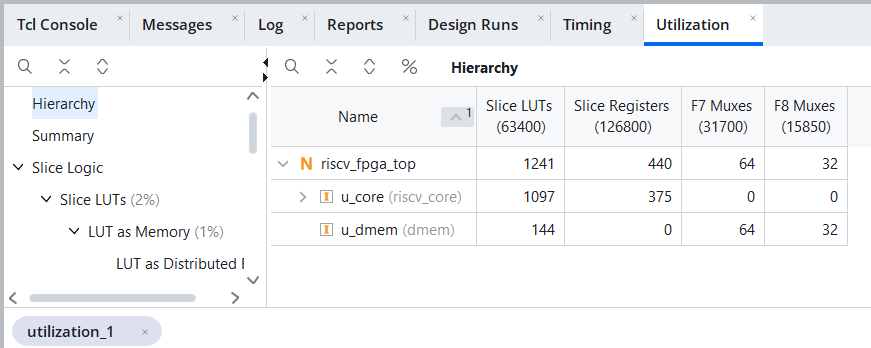
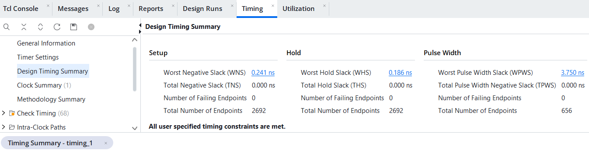
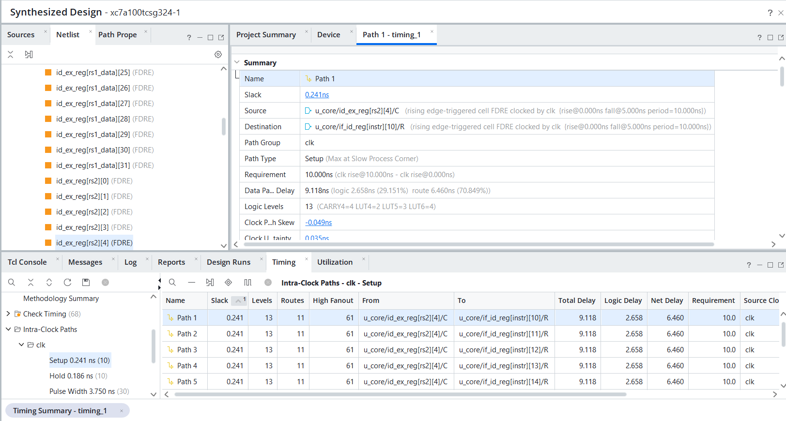

# RV32I 5-Stage Pipelined Processor

A SystemVerilog implementation of the RISC-V RV32I base integer instruction set on a
classic five-stage in-order pipeline, with full forwarding, load-use hazard detection
and branch flushing. Verified with block-level unit tests, six self-checking programs
assembled with RARS, and 23 pipeline assertions; meets 100 MHz on an Artix-7 FPGA after
place and route.

## Features

- All 37 RV32I computational, load/store, branch and jump instructions
- `FENCE` executes as a NOP; `ECALL` / `EBREAK` halt the core; unsupported encodings
  (CSR, M/C extensions, reserved funct3/funct7) are detected as illegal
- Pipeline: IF → ID → EX → MEM → WB
- Forwarding from EX/MEM and MEM/WB into EX; register file write-through covers WB → ID
- One-cycle load-use stall
- Branches and jumps resolved in EX; two-instruction flush when taken
- Separate instruction ROM and data RAM; byte, halfword and word loads/stores with
  sign/zero extension
- Performance counters: cycles, instructions retired, load-use stall cycles,
  taken branches/jumps

## Pipeline

```
   IF            ID              EX               MEM            WB
 ┌─────┐ IF/ID ┌──────────┐ ID/EX ┌──────────┐ EX/MEM ┌───────┐ MEM/WB ┌──────────┐
 │ PC  │──────►│ decode   │──────►│ ALU      │───────►│ data  │───────►│ register │
 │ ROM │       │ regfile  │       │ branch   │        │ RAM   │        │ write    │
 └─────┘       │ imm gen  │       │ forward  │        └───────┘        └──────────┘
    ▲          │ hazard   │       └────┬─────┘
    │          └──────────┘            │ taken branch / jump: redirect PC, flush IF/ID, ID/EX
    └──────────────────────────────────┘
```

## Source Files

| File | Description |
|------|-------------|
| `rtl/riscv_pkg.sv` | Opcodes, ALU operations, control word definition |
| `rtl/control.sv` | Instruction decoder |
| `rtl/alu.sv` | Integer ALU |
| `rtl/branch_cmp.sv` | Branch condition unit |
| `rtl/regfile.sv` | 32 × 32 register file, two read ports, write-through |
| `rtl/imm_gen.sv` | Immediate generation for I/S/B/U/J formats |
| `rtl/forward_unit.sv` | EX operand forwarding select |
| `rtl/hazard_unit.sv` | Load-use detection |
| `rtl/riscv_core.sv` | Five-stage pipeline, halt logic, performance counters |
| `rtl/imem.sv`, `rtl/dmem.sv` | Instruction ROM and data RAM |
| `rtl/riscv_top.sv` | Core with memories |
| `fpga/riscv_fpga_top.sv` | Synthesis top: program ROM initialised from `sort.mem`, store results on output ports |
| `fpga/riscv_fpga.xdc` | 100 MHz clock constraint |
| `sva/riscv_sva.sv` | Pipeline assertions, bound to `riscv_core` |
| `tb/tb_units.sv` | Unit tests for the datapath and decode blocks |
| `tb/tb_riscv.sv` | Runs the test programs and prints a results table |
| `tests/*.s` | Self-checking test programs (RARS assembly) and their hex images |

## Verification

### Unit tests (`tb/tb_units.sv`)

Known-answer and randomized checks against reference models.

| Block | Checks |
|-------|--------|
| ALU | 14 known-answer + 5,000 random |
| Branch comparator | 6 known-answer + 3,000 random |
| Register file | fill/readback, x0, write-through, 2,000 random cycles |
| Immediate generator | 2,000 random immediates × 5 formats |
| Decoder | all RV32I instructions + 15 reserved/unsupported encodings |

### Test programs (`tests/`)

Each program checks its own results and ends with `a0 = 0` on pass or
`a0 = <failing check>` on failure. Every program was first run on RARS as a
reference, then on the core.

| Program | Coverage |
|---------|----------|
| `smoke.s` | Forwarding from each stage, load-use, byte/halfword access, branch flush with a squashed store, JAL/JALR, LUI/AUIPC |
| `alu.s` | All register and immediate ALU instructions: overflow wrap, immediate limits, sign extension, shift amounts above 31, signed vs unsigned compares |
| `mem.s` | Every load/store size and byte lane, negative offsets, loaded value used as the next address, store followed by load of the same word |
| `branch.s` | All six branch conditions taken and not taken with extreme operands, loops, JALR with offset, jump table, three-level nested calls |
| `hazard.s` | Forwarding priority, load into x0, chained loads, AUIPC forwarding, branches and ECALL on the wrong path, back-to-back taken branches |
| `sort.s` | Bubble sort of 16 signed words, checked for order and for the same sum and XOR as the input |

### Assertions (`sva/riscv_sva.sv`)

| Area | Properties |
|------|------------|
| Fetch / redirect | PC word-aligned; target aligned; PC takes the target; IF/ID and ID/EX flushed |
| Load-use | PC and IF/ID hold during a stall; bubble inserted; no load result consumed from EX/MEM; no unresolved load-use reaches EX |
| Bubbles | An invalid ID/EX or EX/MEM slot carries no control signals |
| Architectural | x0 stays zero; no X on fetched instructions, EX operands or write-back data; aligned loads and stores |
| Halt | Fetch stops and PC freezes after ECALL/EBREAK; no register or memory writes once halted |

## Results

Simulated with Questa 2025.2. All programs pass with no assertion failures.

| Program | Instructions | Cycles | CPI | Load-use stalls | Taken branches/jumps |
|---------|-------------:|-------:|----:|----------------:|---------------------:|
| `smoke.s`  |   135 |   159 | 1.178 |   4 |   8 |
| `alu.s`    |   150 |   156 | 1.040 |   0 |   1 |
| `mem.s`    |   118 |   134 | 1.136 |  10 |   1 |
| `branch.s` |   128 |   206 | 1.609 |   2 |  36 |
| `hazard.s` |    77 |    99 | 1.286 |   6 |   6 |
| `sort.s`   | 1,318 | 1,905 | 1.445 | 145 | 219 |

For every program, cycles = instructions + stall cycles + 2 × taken branches/jumps + 4
(pipeline fill), which confirms the stall and flush penalties are exactly one and two
cycles. A cycle-by-cycle pipeline trace of `smoke.s` is in `sim/smoke_pipeline.txt`.

## FPGA Implementation

Vivado, Artix-7 `xc7a100tcsg324-1` (Arty A7-100T), out-of-context, with `sort` in the
4 KB instruction ROM and a 1 KB data RAM.

| Metric | Value |
|--------|-------|
| Slice LUTs | 1,241 (core 1,097, data RAM 144) |
| Registers | 440 (core 375) |
| Clock | 100 MHz, met after place and route |
| Setup / hold slack | WNS +0.031 ns, WHS +0.113 ns |

The critical path is branch resolution in EX: forwarding select → operand mux →
32-bit branch compare → redirect → IF/ID flush (13 logic levels, about 70 % routing
delay). Resolving branches a stage later, branch prediction, or duplicating the flush
signal would shorten it, at the cost of a larger branch penalty or more logic.





## Running

Programs are assembled with [RARS](https://github.com/TheThirdOne/rars) using
*Settings → Memory Configuration → Compact, Text at Address 0*, and the `.text`
segment is exported with *File → Dump Memory* (Hexadecimal Text) as `tests/<name>.hex`.

```
cd sim
vsim -c -do run_units.do       # unit tests
vsim -c -do run_tests.do       # all test programs, with assertions
```

`tb_riscv` options: `+PROG=<file>` runs a single image, `+PIPE` prints the pipeline
every cycle, `+TRACE` prints each retired instruction.

Synthesis: add `rtl/*.sv`, `fpga/riscv_fpga_top.sv` and `fpga/sort.mem` (a copy of
`tests/sort.hex`) as design sources and `fpga/riscv_fpga.xdc` as the constraint file,
top `riscv_fpga_top`, synthesis option `-mode out_of_context`.
